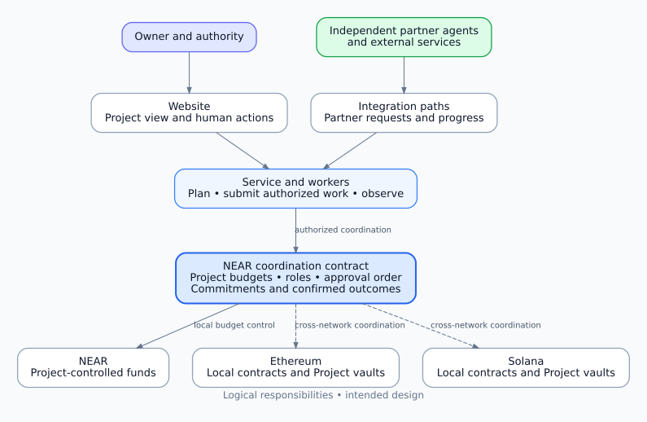
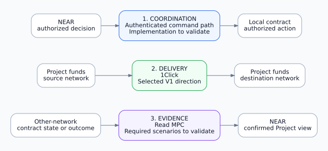

# Architecture

## A coordinated budget with local control

Apodect combines Project-level coordination on NEAR with contract-controlled funds and task allocations on participating networks. The intended architecture has three distinct responsibilities: deciding what is authorized, moving money when necessary, and confirming what actually happened.

The diagrams describe component roles and information flow, not a deployed topology or a promise that all cross-chain actions happen at once. Exact addresses, network-specific storage, and interfaces are not specified here.

## Component map

**Text equivalent:** the owner and authority manage Projects through the website. Independent agents and external services use integration paths. Service workers coordinate authorized operations with the NEAR contract and local contracts. NEAR coordinates the Project budget; local contracts hold and assign funds on their own networks. Delivery moves money, while evidence travels back to support confirmed budget state.

### Workspace and Project experience

The website presents Projects, participants, requests, approvals, funding progress, fees, and task outcomes. A Workspace groups Projects; each Project retains its own budget and vault custody.

The owner sets the Project budget and appoints authority. Authority approves requests and starts Apply. The interface presents these as separate actions and makes waiting, delivery, readiness, execution, and completion distinguishable.

### NEAR coordination contract

NEAR is the common coordination point for Project budgets and permissions. Its intended responsibility is to connect approved requests and their priority with the Project's known funding commitments, local allocations, and confirmed cross-chain outcomes.

The common view must not count a source balance, funds in transit, and the later destination receipt as three separate assets. A reported balance alone is not enough to show that funds are free: they may already be committed to a task or operation.

Coordination on NEAR does not require every possible transfer to travel through NEAR. The demonstration described in How It Works does illustrate collection through NEAR; it does not prescribe every production route.

### Local contracts and Project vaults

Local contracts on NEAR, Ethereum, and Solana support the Project's funds and the agents operating there. Their shared purpose is to enforce local allocation and access conditions, record relevant task activity, and expose the outcomes needed for reconciliation with NEAR.

The same product semantics apply across Ethereum and Solana even though their account and execution models differ. A local contract needs the relevant Project, agent permissions, tasks, and allocations; it does not need an unrestricted global view of every Workspace and network.

Vault custody is separated by Project. Shared coordination does not authorize one Project to spend another Project's funds. The exact number and placement of vaults are engineering details, not implied by this conceptual map.

### Service and workers

The backend and workers support planning, submission of authorized actions, observation, synchronization, and user-facing progress. External integrations let independent partners participate without making one Apodect backend the sole budget gatekeeper.

The service must distinguish an intended action from an accepted action and from a confirmed outcome. Its own record cannot turn an unknown transfer into available money, manufacture approval, or prove that a remote pause has taken effect.

## Three paths that must not be confused

**Text equivalent:** NEAR-origin coordination needs an authenticated path to local contracts. 1Click is the selected first-version route for moving funds between controlled network locations. Read MPC is the selected direction for obtaining relevant other-network facts for NEAR. A delivery observation does not by itself activate an agent allocation, and evidence arriving at NEAR does not itself authorize an outbound command.

### Coordination and authorization

Approvals and Project permissions determine which actions may be performed. When a local contract must act on a NEAR-coordinated decision, it needs to recognize that decision as authorized.

This outbound authorization path uses Chain Signatures. The NEAR coordinator
creates a concrete command binding domain, operation, action, task, amount,
recipient and deadline. The destination verifies its SHA-256 signature and
immutable operation outcome. A separate local MPC simulator signs only finalized
coordinator commands; a relayer cannot submit arbitrary digests for signing.
Read MPC separately authenticates immutable source checkpoints and funding
receipts. See the [protocol](cross-chain-protocol.md) and
[provider capabilities](cross-chain-providers.md).

### Fund delivery

The initial delivery direction is NEAR Intents 1Click. The funding plan may move Project funds to where an approved task needs them, or avoid a transfer when sufficient local funds remain available under the queue's priority rules.

A quote, an accepted transfer request, a source debit, a destination receipt, and a full local task allocation are different milestones. Fees belong to the Project and must not silently reduce the amount promised to the agent. Exact route support, controlled recipients, refund behavior, and actual costs require validation.

### Evidence and synchronization

Read MPC is selected for checking relevant states on Ethereum and Solana for the first version, with required scenarios tested before relying on them. The design cannot assume that every needed fact is supported merely because a general reading capability exists.

Synchronization connects confirmed local events to NEAR's Project-level view. It must distinguish delivery from assignment, assignment from use, and a pause request from confirmed local loss of access. Facts that have not been confirmed remain uncertain; uncertainty is not permission to reuse the affected funds.

## Where control ends

The vault bounds issuance to the approved allocation. After funds reach an agent's independent wallet, the agent can choose downstream operations. Apodect does not automatically control those funds, enforce the purpose reference, or verify each purchase.

Force Cancel is an owner-controlled pause. It can restrict access to controlled vault funds once the relevant local action takes effect. The owner may reclaim available controlled task funds, and authority may restore a task budget separately. Neither action reaches into an independent wallet or reverses an external action already accepted.

The service must show these boundaries. “Pause requested,” “paused locally,” “funds returned,” and “budget restored” must not be represented as the same outcome.

## The shared view

For people and partners, the components come together as a Project view: what was requested, what was approved, what is waiting, what is committed, where delivery stands, what the agent can use, and what was returned or recorded as expense.

The architecture is enforced and tested in the coordinated local environment,
including delivery, outbound authorization and the admitted Read MPC evidence
shapes. This establishes local application behavior. Public MPC operators,
provider availability and liquidity remain separate integration requirements;
see [provider integration requirements](cross-chain-providers.md).

See [How It Works](how-it-works.md) for the normal flow and its shortage, cancellation, pause, and recovery branches. [Concept](concept.md) explains the problem and product boundaries.
