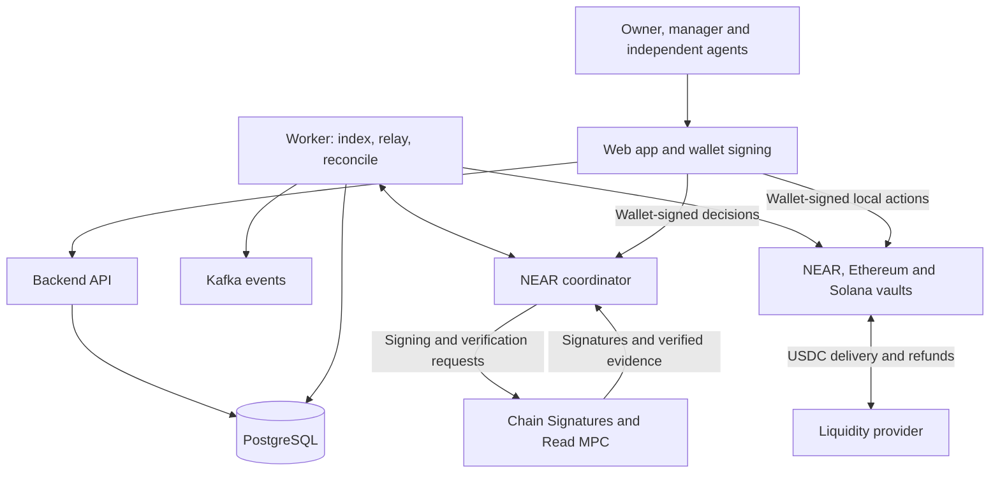

# Architecture

NEAR controls a project's shared funding decisions. Vaults on NEAR, Ethereum and
Solana hold the assets and enforce local allocations. The application prepares
actions, submits authorized work and builds a confirmed view of these contracts.

## State and authority

| Component | Responsibility |
| --- | --- |
| NEAR coordinator | Project owner/manager roles, approval-order queue, funding reservations, constrained commands and reconciliation of confirmed outcomes. |
| Local vaults | Task creation, custody, reservations, full allocations, withdrawals, returns and task controls on their own network. |
| React web app | Profiles, linked wallets and role-aware project management. Users review and sign their own transactions. |
| Rust/Actix Web API | Wallet authentication, project views, stored purpose/report references and unsigned action preparation. |
| Rust worker | Finalized-state indexing, evidence submission, command delivery, liquidity reconciliation and event publication. |
| PostgreSQL and Kafka | Durable application records and a transactional event outbox; Kafka carries published events. Contract state remains authoritative for spending rights. |

The API holds no owner, manager or agent keys. The worker uses separate service
keys for transaction submission. An application record or a provider's success
message cannot grant an allocation or release a commitment.

## Funding across networks

1. An agent creates a task on its execution network. Indexing and verified evidence
   make the request visible to the coordinator.
2. The manager approves the request, then separately reviews and signs **Apply**.
   The coordinator commits the required funds in approval order.
3. The planner uses eligible destination funds first and quotes direct deliveries
   from other networks for the shortfall. NEAR need not be an intermediate custody hop.
4. Chain Signatures signs commands already authorized by the coordinator. Destination contracts
   verify their deployment binding, signature and replay protection.
5. Confirmed reservations, delivery receipts and allocation results advance the
   plan. Read MPC supplies Ethereum/Solana evidence; NEAR uses contract callbacks.
6. The full local allocation enables agent withdrawals. Returns and released
   allocations become eligible for later funding after synchronization.

Approval, source dispatch, destination delivery and task allocation are separate
states. Unknown outcomes keep funds committed. Retrying an observation does not
authorize a second payment. See the [coordination protocol](cross-chain-protocol.md)
for identity, evidence and recovery rules.

## Deployment

Default Compose runs the application, database, broker and one `localnet` service
that manages all three chains and simulated external providers. Its RPC nodes
execute real contracts and test-token transfers. The live override connects the
application to an existing public deployment; public MPC and liquidity execution
still require the checks in [provider integration](cross-chain-providers.md).

Use [application setup](application-development.md) to run the stack,
[backend services](backend.md) for application interfaces, and
[contract rules](contracts.md) for local and coordinated lifecycle differences.
